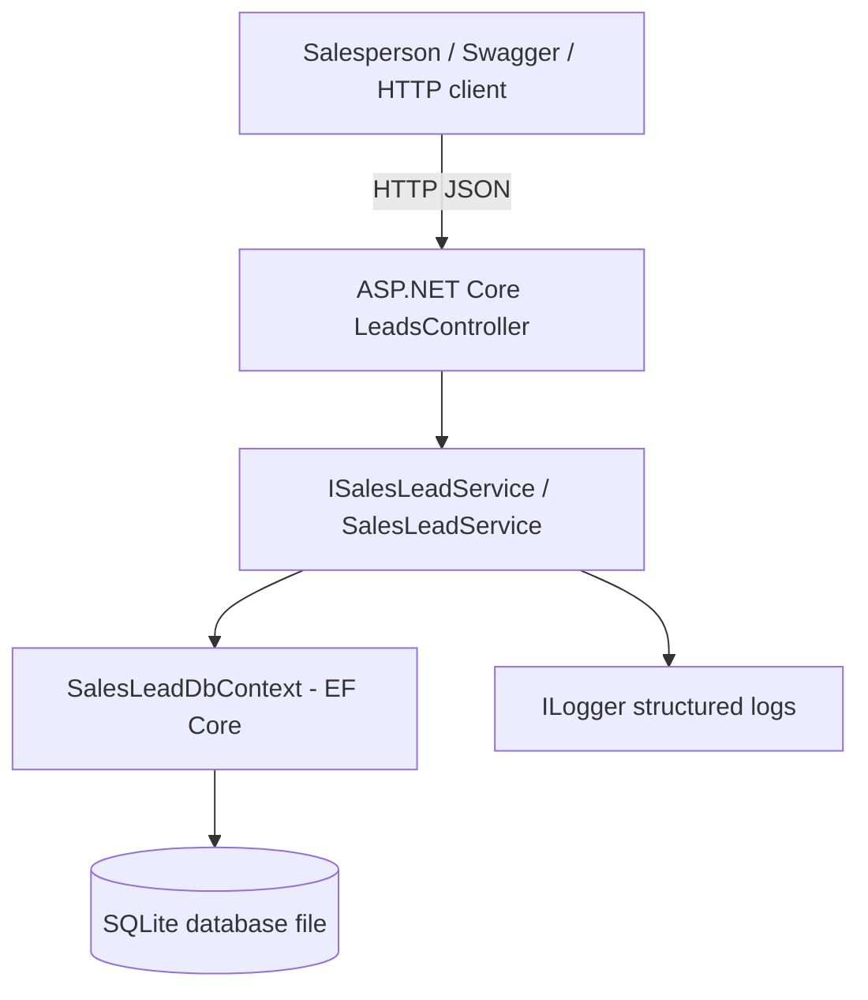

# System Design — Sales Lead Management Tool

## 1. Scope

Implement the backend service layer for Keyloop assessment Scenario C. Salespeople need to see incoming website leads, view an individual lead and its follow-up history, and persist new follow-up activities.

## 2. Architecture

## 3. Component responsibilities

- **Controller:** Defines REST routes, accepts validated DTOs, returns HTTP status codes, and does not contain database logic.
- **Service:** Implements use cases, trims user-provided strings, creates leads/activities, handles missing lead IDs, and maps database entities to response DTOs.
- **EF Core DbContext:** Defines entity sets, field constraints, the lead-to-activity relationship, cascade delete behavior, and an index supporting activity-history queries.
- **SQLite:** Stores leads and activities between application restarts; suitable for a self-contained assessment demo.
- **Swagger/OpenAPI:** Makes the API easy to explore and demonstrate without a separate frontend.
- **ILogger:** Emits structured events for lead and activity creation.

## 4. Data model

**SalesLead**

- `Id` — primary key
- `CustomerName`, `Email`, `Phone`, `VehicleInterest`
- `Status` — defaults to `New`
- `CreatedAtUtc`
- One-to-many relationship with `LeadActivity`

**LeadActivity**

- `Id` — primary key
- `SalesLeadId` — foreign key
- `ActivityType` — e.g. Call, Email, Test Drive
- `Notes`
- `CreatedAtUtc`

Each activity belongs to one lead. Deleting a lead cascades to its activities. Delete endpoints are not exposed in this assessment.

## 5. Main data flows

### List inbox

1. Client sends `GET /api/leads`.
2. Controller calls the service.
3. Service queries leads without tracking and orders newest leads first.
4. API returns a JSON list. Activity collections are not loaded for the inbox response.

### View details

1. Client sends `GET /api/leads/{id}`.
2. Service loads the lead and its activities.
3. Activities are sorted oldest first and mapped to response DTOs.
4. API returns `404` if the lead does not exist; otherwise `200` with details/history.

### Log activity

1. Client sends `POST /api/leads/{id}/activities` with activity type and notes.
2. ASP.NET Core validates the request body.
3. Service checks that the parent lead exists, creates an activity with a UTC timestamp, and saves it.
4. API returns `201 Created`; unknown lead IDs return `404`.
5. A later details request confirms the activity was persisted.

## 6. Technology choices

| Technology | Reason |
|---|---|
| .NET 8 / ASP.NET Core | Stable, familiar platform for a C# REST API |
| EF Core 8 | Parameterized database access and object-relational mapping |
| SQLite | Persistent relational database with no separate server to install |
| Swagger/OpenAPI | Human-friendly API contract and demo surface |
| xUnit | Common .NET test framework |
| EF Core InMemory (tests only) | Fast isolated service tests; not used by the running API |
| `ILogger` | Structured logs using built-in ASP.NET Core logging |

## 7. Validation, reliability and maintainability

- Data annotation validation limits required fields and maximum lengths.
- `[ApiController]` automatically returns `400 Bad Request` for invalid request models.
- Missing lead IDs return `404 Not Found` rather than creating orphan activities.
- Database foreign keys enforce the lead/activity relationship.
- Read-only queries use `AsNoTracking()` where appropriate.
- Async EF Core calls use cancellation tokens.
- Controllers depend on an interface, keeping HTTP concerns separate from use-case logic.

## 8. Observability

- Structured `Information` logs are emitted for lead and activity creation, including IDs.
- ASP.NET Core request logging and framework warnings use configured logging levels.
- For production, add request/trace IDs, latency and error-rate metrics, centralized log collection, health checks, and OpenTelemetry tracing. These are intentionally not added to the small assessment implementation to keep it easy to run and explain.

## 9. Security and production considerations

This is a focused assessment implementation, not a production-ready CRM. Before production: add authentication and role-based authorization; protect personal data; add rate limiting; paginate/filter large inboxes; use managed database backups; configure secrets securely; add EF Core migrations; and add integration tests against a relational database. Only expose Swagger in development.

## 10. Assumptions and trade-offs

- The UI is stubbed by Swagger/cURL because the assessment allows a backend implementation with a simple test harness or API contract.
- One lead is created from one website enquiry; duplicate detection is not specified.
- Activity history is ordered ascending by timestamp (oldest first), which is useful for a salesperson opening a lead.
- The app uses SQLite and `EnsureCreated()` to make setup quick. Production schema changes should use migrations.
- Activity timestamps are UTC to avoid timezone ambiguity.

## 11. GenAI design collaboration

AI was used to help structure the requirements, draft the initial component diagram and suggest a minimal entity/API design. The resulting design was reviewed against the assessment's three acceptance criteria. Before submission, the developer should validate the diagram and API contract against the final code, run the automated tests, and update the README narrative with the exact prompts, edits, bugs discovered, and checks actually performed. AI-generated code is treated as a draft, not proof of correctness.
